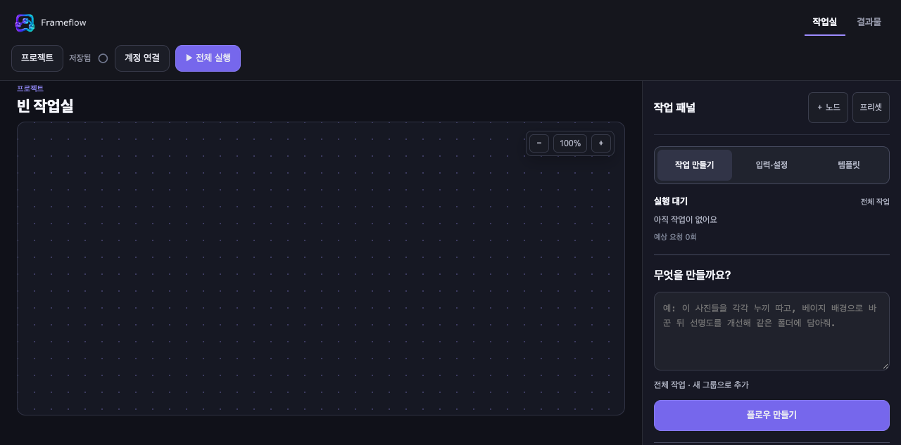
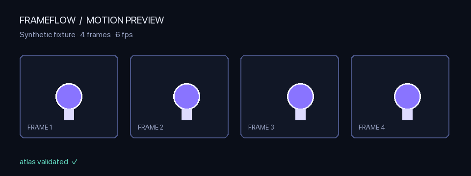

# Frameflow

Frameflow 是一个本地 Web 工作室，用于通过节点图组合图像生成与编辑流程，并以确定性的方式验证和处理结果。

[English](README.md) · [한국어](README.ko.md) · [日本語](README.ja.md) · **简体中文**

## ✨ 核心能力

- **节点式 workflow** — 组合提示词、输入、编辑、合成、重复、预览和动画操作
- **Provider adapter** — 连接官方 provider、本地服务或 mock provider
- **确定性的 motion pipeline** — 验证等宽 atlas、精确拆分单元并编码 GIF/APNG
- **无需账号的 QA** — 使用 fixture 验证 planner、graph、alpha、atlas 和 encoder
- **Local-first** — 浏览器端项目存储，以及默认仅绑定 loopback 的 Local Bridge
- **明确的失败处理** — 不用裁剪、打补丁或静默重试来掩盖无效 graph 和 atlas

## 🖼️ 预览

**工作室** — 使用节点组合图像工作流，并在本地查看结果。



**动效输出** — 验证横向 atlas，精确切分单元格，再编码为 GIF/APNG。



技术规范请查看 [motion atlas 卡片](docs/assets/motion-atlas-contract.png)，完整步骤请查看 [Demo 指南](docs/DEMO.md)。

## 🚀 运行

要求：**Node.js 22+**

```bash
npm install
npm run setup
npm run dev
```

打开 <http://127.0.0.1:4310>。

```bash
npm run build
npm start
```

修改本地端口：

```bash
WEB_PORT=4320 BRIDGE_PORT=4329 npm start
```

## 🔌 Provider 与安全

默认测试路径使用 mock 响应和 fixture。真实 provider 必须显式 opt-in，并按照官方文档通过本地环境变量配置。

不要将 credential、token、cookie、device authorization、会话文件、个人路径、真实 tunnel URL 或个人生成结果提交到仓库。详情请查看[安全策略](SECURITY.md)。

## 🎞️ Motion atlas 契约

Frameflow 不会为了让 provider 结果通过而任意裁剪或打补丁。它会验证横向等宽单元、准确帧数、无相邻单元 bleed、无 ghost trail、无文字/水印/边框；不符合规格时直接失败。

## ✅ 验证

```bash
npm test
npm run typecheck
npm run agent:check
npm run public:check
npm run build
```

基本验证无需账号或 API key。

## 📦 仓库结构

```text
web/       Next.js 工作室和浏览器端 encoder
bridge/    Local Bridge、provider adapter、planner 验证
shared/    command catalogue 和 AI harness
tests/     offline 回归与集成测试
qa/        已清理的 QA fixture 和场景记录
docs/      架构与决策记录
```

## 📄 文档

- [公开发布检查清单](PUBLIC_RELEASE_CHECKLIST.md)
- [安全策略](SECURITY.md)
- [贡献指南](CONTRIBUTING.md)
- [许可证](LICENSE)
- [品牌与商标](TRADEMARKS.md)
